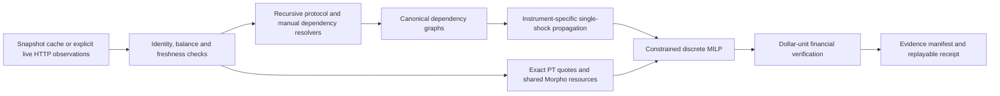

# Blast Radius — Ten Positions. One Hidden Bet.

**Belem Capital · DeFi Risk Dependency Challenge**

You think you own ten independent investments. What if five are secretly the same bet?

Blast Radius discovers shared DeFi dependencies, lets you stress them, and prices the cheapest reductions that meet a portfolio manager's risk mandate. Every headline is reproducible from frozen evidence. The $10M allocation is illustrative; the instruments, protocol API responses and captured swap quotes are real.


**DISCOVER → ATTACK → COLLAPSE → RESCUE → PROVE**

**Final release:** [JUDGE_GUIDE.md](JUDGE_GUIDE.md) has exact clicks, expected
figures, technical answers and recovery. [RELEASE_REPORT.md](RELEASE_REPORT.md)
records newly executed validation and remaining submission actions. The older
`JUDGE_READINESS.md` preserves the earlier financial correction history.

- **Find My Weakest Point:** recursively discover and canonically deduplicate dependencies; rank shared points by conditional damage. The bundled book reveals **wstETH under five positions**, a Pendle PT and four Morpho vaults. The result is computed, not selected in advance. Ethereum is excluded from the shared-point reveal because settlement-chain exposure is trivial; it remains selectable.
- **Attack and collapse:** select any discovered dependency and vary its intrinsic shock from 0–100%. Actual contributing paths animate; inspectors explain their exposure and attributed loss. Animation conveys causal order, not incident time.
- **Build Rescue Plan:** minimize execution costs, a conversion reserve and thirty-day foregone carry on a 5% grid, respecting available quotes, funded claims, shared market liquidity and position locks. Infeasible and unresolved results are distinguished.
- **Show Me the Evidence:** inspect contracts, markets, allocation balances, coefficients, raw source records and timestamps. Download a decision receipt and reproduce its calculations offline.

**Challenge this portfolio:** construct a different book from a **14-instrument frozen Ethereum catalog**, with dynamic Add/Remove controls and up to ten selected positions at $0–$2M each in $50k steps. New admissions are **PT-apyUSD, PT-USD3, Vault Bridge WETH and Vault Bridge USDC**, each using its own captured data. Pendle exits retain exact captured $50k–$1M trades and original costs; larger holdings can remain partly unprotected. Morpho funded claims and shared liquidity remain binding. **Reset** restores the original $10M demonstration. This is a bounded catalog, not universal wallet/protocol support. [Catalog validation and limits](docs/CATALOG_VALIDATION.md) · [Four-feature assessment](docs/IMPROVEMENT_REVIEW.md).

## Independently audited result

For a hypothetical **100% intrinsic wstETH shock** and a **$500,000 accounted-loss limit**:

| Quantity | USD |
|---|---:|
| Original conditional scenario loss | 2,361,622.14 |
| Residual conditional loss after reductions | 481,047.34 |
| Execution/mark shortfall including assumed gas reserve | 15,252.51 |
| Assumed external-cash conversion reserve | 2,700.00 |
| **Accounted loss: residual + execution + conversion** | **498,999.85** |
| Thirty-day foregone carry | 4,417.54 |
| **Economic protection cost: execution + conversion + carry** | **22,370.05** |
| Gross capital sold | 2,700,000.00 |
| **Net capital released: sold − execution − conversion** | **2,682,047.49** |

Reduce PT-wstETH **70%**, Steakhouse ETH **100%** and Steakhouse USDT **100%**. Seven positions remain untouched. Lock PT-wstETH and the same $500,000 target becomes infeasible: minimum accounted loss is **$1,004,800** under the model and captured candidate set.

The final audit corrected a critical financial assumption: a PT claim on a worthless underlying cannot retain an unsupported 5% recovery. PT loss now follows the underlying one-for-one at a fixed discount factor. **The earlier $2.31M / $498,866 / $21,753 / $3.38M headlines are superseded.**

An independent script reconstructs the numbers from raw data with Decimal arithmetic, without importing the application's financial engine. It enumerates **4,084,101** combinations across the five affected positions. Its relaxed minimum equals the independently liquidity-verified plan, proving the stated grid optimum. [Independent audit](artifacts/judge_independent_audit.json) · [Final readiness report](JUDGE_READINESS.md).

## Does protection make economic sense?

The manager supplies the stress limit; it is a risk-policy constraint, not an estimated probability. The mixed-integer program minimizes:

`execution + conversion reserve + nonnegative snapshot APY × sold notional × 30/365`

subject to:

`residual conditional loss + execution + conversion reserve ≤ manager's limit`

and one available candidate per position, locks, vault claims and shared liquidity resources. Optimality is proved over available discrete candidates, not arbitrary continuous trade sizes.

The economic decision question is answered explicitly **for this plan versus holding**, under a binary scenario assumption:

`expected net benefit = assumed scenario probability × conditional loss avoided − economic protection cost`

This plan avoids **$1,880,574.80** of conditional damage. Its thirty-day break-even scenario probability is **1.189533%**. At an assumed **0.5%**, expected net benefit is **−$12,967.18**; at **2%**, it is **+$15,241.44**. The interface accepts a judge's probability assumption and shows both signs.

**The system does not estimate that scenario probability.** The threshold applies to the whole plan, not every marginal reduction. This is least-cost protection for a specified mandate plus an economic comparison; it is not an unconstrained expected-return optimum or a claim that investors should sell today. Foregone carry is a full-horizon approximation; cash earns zero, and other scenarios and risk preferences are outside this comparison.

Preserved research pages compare Monte Carlo expected loss with carry and supported exit costs using explicit incident priors. Those priors do not establish the probability of this wstETH scenario. The separate research model compounds independent node shocks and must not be treated as the same numerical model.

## Evidence and financial limits

The original book uses composite captures from **2026-10-10 18:01:08 to 21:51:16 UTC**. Its Pendle quotes were retrieved **21:49:04–21:51:16 UTC**. New admitted catalog evidence was retrieved **2026-10-11 02:24:45–02:29:01 UTC**, with RPC decimals at block `0x18f43b9`. Each response has its own retrieval time; marks and market APYs retain their own provider/capture times. These are not synchronized observations at one block. Quote-bundle `captured_at` is assembly time, not the age of every underlying observation.

| Classification | Evidence | Boundary |
|---|---|---|
| Protocol API observations | Pendle active markets/PT underlying; Morpho funded allocations, debt, supply, collateral and liquidity; 80 Pendle quotes | Protocol-reported state, not independently replayed storage proofs or guaranteed future fills |
| Cached RPC observations | Eight input/output token decimals at Ethereum block `0x18f3e5b` | PT-reUSD has **6** decimals; block timestamp independently re-fetched as **21:48:47 UTC** |
| Sourced manual relationships | Wrapper backing and issuer links with documentation URLs | Versioned file hashes, not invented observation dates or complete reserve proofs |
| Integration hypotheses | Manual token-level oracle names | Not verified deployed integrations; actual Morpho market oracle addresses are separately API-observed |
| Modelling assumptions | Transmission coefficients, recovery, conversion, gas and carry | Hypothetical inputs; not measured failure outcomes or observed trade costs |

Important financial boundaries:

- Alternate paths through one claim use the strongest supported channel; separate funded allocations add. Dependency columns and sequential edge attributions are not additive dollars at risk.
- Lending losses use the **incremental aggregate collateral shortfall divided by supply**. At partial shocks, pooling can understate borrower-level losses and omits liquidation incentives, timing and market feedback. The result models economic impairment, not the timing of vault share-price recognition.
- PT claims transmit underlying USD mark changes **one-for-one**, holding the discount factor fixed. Generic issuer, wrapper, oracle and liquidity coefficients remain disclosed assumptions; they do not describe legal recoveries.
- **PT exits return the underlying token, including wstETH.** Rescue requires conversion to external cash **before** failure. The **10 bps conversion reserve** is assumed; a second-leg cash quote is not provided. The **2 bps gas reserve** is also assumed. Leaving proceeds in wstETH would preserve its risk.
- Quote `amountOut` is valued at its captured output mark; its reported fee is already included. The **1% slippage tolerance is not a guaranteed fill price**. A worse fill can breach the target's $1,000.15 quoted buffer. No transaction is submitted.
- Morpho bounds use funded allocations and shared market capacity, counted once. Withdrawal queues, pauses, future liquidity and executable transactions are not certified. Residual vault exposure proportions are assumed unchanged after reductions.
- Dust below the rounded 0.1% allocation threshold and zero-funded collateral are omitted. Two positions contain unresolved collateral. Loan-asset issuer risk, complete backing, tranche waterfalls, feedback and FX are incomplete.
- Source hashes establish reproducibility and detect local changes; they are not signatures or attestations from data providers.

The [final audit](JUDGE_READINESS.md) explains these boundaries and the critical corrections made to the older research exit adapter.

## Run and reproduce

Python 3.11+; the audited environment uses Python 3.13. Install dependencies once with internet, then presentation and reproduction run offline.

```powershell
python -m venv .venv
.venv/Scripts/python.exe -m pip install -e .
.venv/Scripts/python.exe -m streamlit run app/Home.py --browser.gatherUsageStats false
```

Open **http://localhost:8501**. On macOS/Linux use `.venv/bin/python`. **Snapshot Mode** is the default and forces the historical clients offline; no CDN, wallet, key or network request is required during the demo. Live Mode uses a separate request client and never reads or overwrites the frozen response cache.

## Live Mode

Select **Live Mode**, choose up to ten instruments from the same 14-instrument catalog, then click **Fetch fresh data & discover**. Discover shared dependencies, select an attack and severity, inspect the recalculated losses and collapse paths, and calculate an **indicative model rescue** when all required observations pass validation. **Use offline Snapshot Mode** returns to the validated demonstration in one click.

For the previously verified scope, click **Load $1M Hakutora live example**, then **Fetch fresh data & discover**. This explicitly selects one illustrative Hakutora USDC holding, the cbBTC scenario and the strict 15-minute policy; it does not fetch automatically or guarantee freshness. A rejected full-book request never silently switches portfolios. Stale Morpho errors identify the holding, collateral market, provider timestamp and age; the timestamp window is marked partial when acquisition fails. Wait for provider updates, explicitly select another portfolio, or use Snapshot Mode.

Live acquisition retrieves all eight admitted Morpho vaults when direct PT positions need lending-contagion discovery. Morpho-only books retrieve their selected vaults and every funded market used by those vaults. Each shared lending market uses one canonical observation. Pendle metadata and timestamped market data are retrieved where the graph requires them. The receipt records the vault discovery scope; this is not a complete Morpho scan. User allocations are hypothetical USD amounts, not imported wallet balances.

Morpho risk valuations use integer native balances and one timestamped USD price per token per run. Provider display USD fields can use inconsistent cached marks; they are preserved as evidence, rather than used to reconcile token balances. Native supply minus debt must equal liquidity within one base unit, and vault allocations must reconcile within integer rounding. The unchanged financial validator then checks the derived USD values. Missing amounts, decimals, prices or price timestamps reject the run. Risk-token prices use the selected risk window; they are separate from the execution marks below.

The default quote grid requests four exact trades per selected PT (25%, 50%, 75%, 100%). The optional 5% grid requests twenty. These are subsets of the existing optimizer's candidate grid; optimality applies only to available candidates. Input tokens are rounded down to integer units, and sold notional uses that actual token amount at the fresh input mark. Outputs are never scaled or extrapolated. USD marks use Pendle provider timestamps; token decimals are checked against fresh timestamped Ethereum RPC observations. Partial quote failures remove only those sizes; no valid quote for a selected PT means risk-only analysis. Risk-only capture can also be selected explicitly.

The strict live standard and command-line default remain **15 minutes for provider risk states and risk-observation skew**. At the user's request, the Live interface now opens with **Maximum risk-data age = 60 minutes**, applying that window to both age and timestamp spread. Select **15** for strict validation. Data outside the strict standard is prominently labelled **delayed risk observations**, including any indicative rescue and the receipt classification; passing the wider policy is not certification of fresh live data. Changing this setting invalidates the displayed analysis and requires a new fetch. Both the selected policy and the strict-standard result are recorded in the receipt.

**Execution USD marks, quote request times and the RPC block still expire after 2 minutes**, with **15 seconds of future-clock tolerance**. HTTP connect/read timeouts are 3.05/12 seconds with a 180-second capture budget. Limits are application policy, not provider guarantees. Missing provider timestamps, inconsistent native balances, allocations that do not reconcile, inactive markets, errors and risk data outside the selected window reject analysis. Stale execution data blocks optimization while validated risk analysis remains available. Freshness is checked on each action, after solving and on a 15-second UI timer. An API outage or 429 never silently loads snapshot data; the user selects the explicit offline fallback.

Manual wrapper/issuer relationships, token-level oracle hypotheses, transmission coefficients, aggregate recovery, residual exposure proportions, gas and cash conversion remain disclosed mappings or assumptions. Unknown collateral blocks rescue calculation. **No executable rescue plan is claimed:** the cash-conversion leg is unquoted and Morpho withdrawal queues, permissions and transactions are uncertified. Quotes are indicative observations, not guaranteed fills. Data is asynchronous, not atomic or fully live end to end. See the [pre-implementation feasibility review and API limitations](docs/LIVE_DATA_LIMITS.md).

Each capture and decision saves a self-contained receipt under `artifacts/live/` and offers a download. It embeds exact HTTP requests/responses, individual retrieval times, provider freshness checks, quote sizes, mappings, catalog, assumptions and model hashes. New `blast-radius-native-live-v2` receipts also record the normalization ledger and adapter source hash; original v1 receipts remain replayable. Replay reconstructs graphs, losses and candidates offline and audits any plan at the original decision time:

```powershell
.venv/Scripts/python.exe scripts/verify_receipt.py artifacts/live/<receipt-sha256>.json
.venv/Scripts/python.exe -m unittest discover -s tests -p test_live.py -v
.venv/Scripts/python.exe scripts/run_live_analysis.py --positions hakutora-usdc --dependency token:ethereum:0xcbb7c0000ab88b473b1f5afd9ef808440eed33bf
```

Receipts detect local changes but are not provider signatures. Historical replay never makes old evidence fresh. Replay requires the matching model source version. Existing archived snapshot receipts likewise retain the source hashes of the version that created them; generate a new receipt with this version to verify current code.

```powershell
.venv/Scripts/python.exe -m unittest discover -s tests -v
.venv/Scripts/python.exe scripts/build_fire_drill_artifacts.py
.venv/Scripts/python.exe scripts/audit_judge_readiness.py
.venv/Scripts/python.exe scripts/verify_receipt.py
```

All 89 tests passed after the native-unit correction, including the original 47 financial regressions and 42 live API/UI integration tests. They cover zero/monotonic stress, PT claim parity, overlap, funded allocations, shortfalls, shared liquidity, locks, discrete optimization, solver statuses, exact-size quotes, timeouts, HTTP/GraphQL failures, rate limits, stale/missing timestamps, incomplete balances, receipt replay/tampering, expiry during discovery, obsolete locks and one-click offline fallback. The new cases also test native units, inconsistent display USD marks, price expiry, adapter replay and the actual Live button. The original $2,361,622.14 scenario loss and $498,999.85 accounted-loss baseline remain unchanged. Snapshot source manifests hash Python model code and configuration with LF-normalized UTF-8 text.

Reproduce the modified-book audit separately:

```powershell
.venv/Scripts/python.exe scripts/build_challenge_artifacts.py
.venv/Scripts/python.exe scripts/audit_portfolio_challenge.py
.venv/Scripts/python.exe scripts/build_catalog_artifacts.py
.venv/Scripts/python.exe scripts/audit_catalog.py
```

Optional browser rehearsal, after installing `playwright` and Chromium once:

```powershell
.venv/Scripts/python.exe -m pip install playwright
$env:PLAYWRIGHT_BROWSERS_PATH = "$PWD/.playwright-mcp/browsers"
.venv/Scripts/python.exe -m playwright install chromium
.venv/Scripts/python.exe scripts/verify_fire_drill.py --record
.venv/Scripts/python.exe scripts/verify_portfolio_challenge.py
.venv/Scripts/python.exe scripts/verify_catalog.py
.venv/Scripts/python.exe scripts/record_demo.py
```

Browser verification blocks external requests and exercises discovery, propagation, rescue, economics, locks, infeasibility, evidence, receipt download, reset, native fallback and research pages. Additional rehearsals cover resizing/removal, singleton books, quote-limited infeasibility and constructing an entirely new catalog portfolio with three independently audited scenarios and receipts.

## Two-minute pitch and fallback

[Exact pitch and click cues](DEMO.md) · [120-second MP4 demonstration](artifacts/demo_video/blast-radius-two-minute.mp4) · [Original browser recording](artifacts/demo_video/blast-radius-two-minute.webm) · [Screenshots](artifacts/screenshots) · [Browser verification](artifacts/fire_drill_verification.json).

If the custom component fails, open **http://localhost:8501/?fallback=1**; native controls use the same Python calculations. If the application cannot run, play the local MP4 file; the original WebM is also retained. If video playback fails, use the six `FireDrill_*.png` screenshots with the pitch and independent audit. These are labelled recorded evidence, not a live run.

The frontend is a local JavaScript/SVG Streamlit v2 component. Python, NetworkX and SciPy/HiGHS implement discovery, deterministic stress and mixed-integer optimization. Original Position, Portfolio, Replay, Track Record and Market Scan research is preserved in the sidebar. [Archived research documentation](docs/RESEARCH_README.md) retains previous work; the current audit supersedes its older execution claims.

## Architecture and audit boundaries



`sources` captures data; `discovery` expands claims into a directed graph;
`fire_drill/model.py`, `execution.py`, `optimize.py` and `evidence.py` calculate
stress, admit exits, solve and record decisions. Live acquisition and replay use
`fire_drill/live.py`, with native-unit acquisition/normalization and v2 replay in
`app/live_data.py`; the offline cache remains separate. See [judge Q&A](JUDGE_GUIDE.md#e-technical-qa)
for model formulas and constraints. DefiLlama supports the preserved research and
historical replay; Pendle and Morpho supply the fire-drill protocol observations.
Source URLs remain in raw records and manual mappings. The repository uses the
[MIT license](LICENSE). Optional browser tools are development dependencies.

Real HTTP Hakutora USDC/cbBTC analyses are checked in under
[`artifacts/certified_live/`](artifacts/certified_live), including the original
$901,381.95 / $496,300.07 result and a fresh release run ($901,381.52 / $496,299.83).
Both passed freshness at their recorded times and separate Decimal reconstruction.
A further real browser capture produced $902,209.66 / $496,755.31 and also passed
freshness, receipt download/replay and the independent audit.
Only this Morpho position is certified; withdrawal execution and a live Pendle
exact-size quote workflow remain uncertified. Historical full-book and Pendle
rejections are retained. Replay the observations offline:

```powershell
.venv/Scripts/python.exe scripts/verify_receipt.py artifacts/certified_live/hakutora_20261011_receipt.json
.venv/Scripts/python.exe scripts/verify_receipt.py artifacts/certified_live/hakutora_release_20261011_receipt.json
.venv/Scripts/python.exe scripts/audit_live_reference.py
```

After fixing the USD display inconsistency, a real ten-position browser run at
**2026-10-11 05:22:54 UTC** produced **$2,359,706.70** for the hypothetical 100%
wstETH shock. Provider risk timestamps spanned **04:51:02–05:21:35 UTC**. It passed
the selected **60-minute** policy, failed the strict 15-minute standard, and is
labelled **delayed risk-only analysis**. Sixteen exact Pendle quote requests were
captured, but incomplete manual coverage in Steakhouse USDT and Yearn OG USDC
blocked rescue; this does not certify an end-to-end Pendle rescue. A separate
delayed Hakutora/cbBTC run at **05:24:19 UTC** produced **$901,368.61** loss and
**$496,292.74** accounted loss with a **45% indicative reduction**. Its 21 options
were independently enumerated. A strict Hakutora request was rejected for stale
vault state. [Evidence, timestamps and independent audit](artifacts/certified_live/native_normalization_audit.json).

```powershell
.venv/Scripts/python.exe scripts/verify_receipt.py artifacts/certified_live/full_book_native_delayed_20261011_receipt.json
.venv/Scripts/python.exe scripts/audit_native_live.py artifacts/certified_live/full_book_native_delayed_20261011_receipt.json
.venv/Scripts/python.exe scripts/audit_live_reference.py artifacts/certified_live/hakutora_native_delayed_20261011_receipt.json
```

No universal wallet support, calibrated scenario probability, atomic live state or
guaranteed execution is claimed. Dependency mapping is incomplete; mathematically
feasible rescue remains conditional on recovery and execution assumptions.
