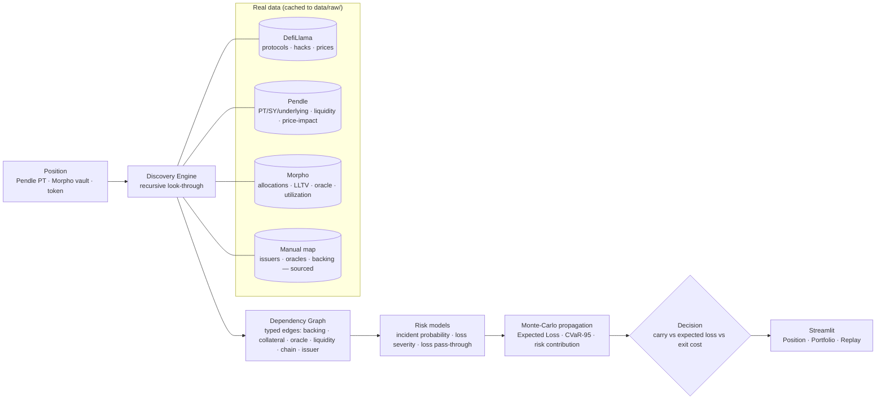

# 💥 Blast Radius

**What is the blast radius of a DeFi position when one of its hidden dependencies fails — and is the expected loss from staying high enough to justify exiting despite slippage?**

Blast Radius is a working Python engine + Streamlit dashboard for the BSA EPFL × **Belem Capital** *DeFi Risk Dependency Challenge*. For a live on-chain position it (1) **discovers hidden dependencies** by recursive look-through, (2) **propagates failure** through the dependency stack with Monte-Carlo, and (3) returns a defensible **STAY / REDUCE / EXIT** call — proven on the real **Stream Finance → Elixir deUSD** collapse of November 2025.

> *Belem's brief:* "Build a working risk system that, for an on-chain position, automatically discovers its hidden dependencies … estimates the economic impact if a dependency fails and shows how the incident propagates … and answers the portfolio manager's real question: is the expected loss from staying high enough to justify exiting despite slippage and execution costs?"

Everything runs on **real data** (DefiLlama, Pendle, Morpho), cached to disk so the demo is **offline and reproducible**. Nothing is invented; every manual or reconstructed fact is labelled in the UI with a source.

---

## The hero result (Replay tab) — real Nov-2025 prices

You hold **$1,000,000 of Elixir sdeUSD**, a yield-bearing dollar trading at peg. Underneath, **~65% of deUSD's backing was a loan to Stream Finance**, collateralised by Stream's xUSD. Blast Radius discovers that hidden chain and watches the **upstream** asset:

- **Nov 1–3:** xUSD at peg → **REDUCE** (already cautious: the opaque Stream dependency is a concentrated risk).
- **Nov 4:** Stream discloses a ~$93M loss and freezes xUSD; **xUSD breaks to $0.95** — but deUSD/sdeUSD are *still at peg ($1.07)*. Blast Radius flips to **EXIT**.
- **Nov 7:** deUSD and sdeUSD collapse to **~$0.01**.

**Exiting on the Nov-4 signal (at $1.07) avoids a 99.7% loss** — three days before the asset you held visibly broke. A price-watcher staring at sdeUSD's own price only reacts on Nov 7, after the drop. The avoided-loss number is computed from the **real sdeUSD price series**, never assumed.


---

## What it does (three tabs)

| Tab | What you see |
|---|---|
| **Position** | Input a live position → interactive **dependency graph** (live-API vs manual edges) coloured by risk → per-node risk table → loss histogram → **STAY/REDUCE/EXIT** verdict with a plain-English reason → **what-if** panel that forces any dependency to fail and re-propagates. |
| **Portfolio** | A book of up to 10 positions → **shared-dependency detection** ("5 of 10 depend on Lido") → position×dependency **exposure heatmap** → ranked actions by carry-minus-loss. |
| **Replay: Stream Finance** | Day-by-day replay on real prices: timeline slider, per-day verdict + narrative, %-of-peg chart with the EXIT-signal marker, and the daily dependency-graph state. |

Live look-through of a Pendle PT-sUSDS position — the 5 layers (settlement chain, Pendle AMM, underlying→issuer, oracle, lending market) fall out of generic recursion; node colour = share of expected loss, dashed edges = sourced manual facts:


---

## Architecture



---

## Methodology

### 1. Recursive look-through discovery (`blast_radius/discovery/`)
A position is the graph root. Per-kind resolvers expand it into typed dependency edges, then the engine recurses over token nodes until it reaches base assets or the settlement chain. **The 5-layer Pendle example falls out of generic recursion — it is not hard-coded.**
- **Pendle PT** → settlement chain, the Pendle **AMM** (exit venue), the **underlying** (SY→asset), and the **lending markets that hold the PT as collateral** (contagion channel) with their **oracles** and **LLTV**.
- **Morpho vault** → each allocated **market** (with LLTV, utilization, oracle address) → **collateral token** → which recurses (a PT collateral unwraps into *its* underlying and AMM; a wrapper into its backing → issuer).
- Each edge carries a **dependency type**, an **exposure %** (allocation share / backing share), and its **data source**. Facts the APIs don't expose (some oracles, off-chain issuers, backing) come from a small **manual map** with a source URL per entry and render as **dashed "manual" edges**.

### 2. Risk models (`blast_radius/models/`)
- **Incident probability** — base-rate hazard per DefiLlama **category** and per hack **classification** from the real `/hacks` dataset joined to `/protocols`; stablecoin-like classes blend a documented **depeg prior** (because depegs aren't "hacks"). A gradient-boosting panel model is trained and evaluated honestly (below).
- **Loss severity** — Beta per risk category; the means are informed by the **empirical loss/TVL distribution per classification** computed from `/hacks`.
- **Loss pass-through** — a coefficient per edge type (how much of a child's shock reaches its parent), plus an explicit **oracle → LLTV liquidation** rule. Calibrated against real 2025 incidents (see below).

### 3. Monte-Carlo propagation (`blast_radius/risk/propagate.py`)
Each path samples an intrinsic shock at every node (incidence × severity) and propagates it **up** the graph with a *multiplicative survival* rule that bounds every node in [0,1] and **does not double-count** a shared ancestor reached via several paths. Outputs: **loss distribution, Expected Loss, CVaR-95**, and a per-node **contribution** that attributes expected loss to the dominant dependency path.

### 4. Exit cost & decision (`blast_radius/risk/`)
- **Exit cost** is real: Pendle PT uses the **SDK swap price-impact** at the position size (with a size→impact curve); a Morpho vault uses **withdrawable liquidity** (and an illiquidity penalty beyond it).
- **Decision:** compare the expected net P&L of holding (`carry − expected loss`) against the cost of exiting; **EXIT** when expected loss beats carry by more than the exit cost, **STAY** when carry covers the loss and the tail is tolerable, **REDUCE** otherwise (including a fat **CVaR-95** tail). The reason names the dominant risk path.

---

## Model evaluation (reported honestly)

Incident model: a gradient-boosting classifier on a **15,350-row protocol×year panel** (2021–2025), time-split (train ≤ 2023, test 2024–25), isotonic-calibrated. Test prevalence **0.95%** (96 positive protocol-years) — severe class imbalance, as expected.

| Model | ROC-AUC | PR-AUC | Brier |
|---|---|---|---|
| Gradient-boosting panel | 0.615 | 0.013 | 0.0094 |
| **Category base-rate (baseline)** | **0.627** | **0.018** | 0.0098 |

**The base rate is not beaten** by the ML model on this data — so **base-rate priors remain the production backbone** and the model is reported for transparency, not inflated claims. (Regenerate with `python scripts/train_incident_model.py` → `artifacts/metrics.json`.)

**Pass-through calibration (real Nov-2025 incidents, small sample stated openly):** on Nov 7, Stream xUSD had lost ~87% and deUSD ~99%; with ~65% Stream-backed, the "fundamental" deUSD loss ≈ 0.65 × 0.87 ≈ 57% but the market overshot to ~99% — an overshoot factor of **≈1.7×** in a confidence-run. Our `backing` pass-through (0.95) is deliberately conservative against that panic overshoot.

---

## Data sources (all free, no API key)
- **DefiLlama** — `/protocols` (catalog, category, chains, TVL, audits, listedAt), `/protocol/{slug}` (TVL history), `/hacks` (1,299 incidents), `coins.llama.fi` current/historical/`chart` prices.
- **Pendle** `api-v2.pendle.finance` — `/v1/{chain}/markets/active`, `/v2/.../data`, `/v2/sdk/.../swap` (real price-impact), `/v1/.../assets/prices`.
- **Morpho** `blue-api.morpho.org/graphql` — vault allocations, markets, collateral, LLTV, oracle address, utilization (current + historical).
- **Manual map** (`data/manual/dependencies.yaml`) — issuers / oracles / backing the APIs don't expose; **one source URL per entry**, labelled "manual" in the UI.
- **Replay** (`data/replay/stream_snapshot.yaml`) — the contagion *structure* is reconstructed from sourced post-mortems (The Block, Pharos, BlockEden, CoinDesk) and labelled "reconstructed"; the *price series* are real DefiLlama data.

Every response is cached to `data/raw/` (committed) so the demo runs offline. `python refresh_cache.py` rebuilds the cache.

---

## Assumptions & limitations (openly)
- **Incident base rates** use documented depeg priors for stablecoin-like classes that `/hacks` under-counts; flagged as priors in the UI.
- **Severity loss/TVL** uses *current* protocol TVL as a denominator (post-incident) — a rough approximation, stated.
- **Pass-through** is calibrated on a **small sample** (n≈3 real 2025 events); we expose sensitivity rather than claim precision, and linear multiplicative transmission understates panic overshoot.
- **Incident ML model** does not beat the base rate under 0.95% prevalence — base rate is the backbone.
- Some exotic collateral (e.g. `reUSD`, `syrupUSDC`) is **not yet in the manual map** and is shown as an **opaque** node (no deep look-through) rather than guessed.
- Research tooling for a hackathon — **not financial advice**.

---

## How to run

```bash
python -m venv .venv
.venv/Scripts/pip install -e .          # macOS/Linux: .venv/bin/pip
python refresh_cache.py                 # one network run to build data/raw/ (optional; cache is committed)
./run.ps1                               # Windows   (macOS/Linux: ./run.sh)
```
`run.ps1` launches the dashboard from cached data. For a strict offline demo: `set BLAST_RADIUS_OFFLINE=1` (PowerShell: `$env:BLAST_RADIUS_OFFLINE=1`) before launching.

**Demo positions** (finalised from live data): a Pendle **PT-sUSDS** PT (also used as Morpho collateral — the full 5-layer story) and the **Morpho Smokehouse USDT** vault (22-market layered collateral). A 10-position sample book is in `data/book/sample_book.json`.

---

## Repo structure
```
blast_radius/
  sources/     defillama · pendle · morpho (cache-through clients)
  discovery/   graph · resolvers · engine (recursive look-through)
  models/      incidents · severity · passthrough
  risk/        propagate (Monte-Carlo) · exit_cost · decision
  portfolio/   book (shared deps + ranking)
  replay/      stream (Nov-2025 replay)
app/           Home + pages (Position · Portfolio · Replay) + components
scripts/       train_incident_model.py
data/          raw/ (cache) · manual/ · replay/ · book/
```

MIT licensed. Built with Claude Code.
