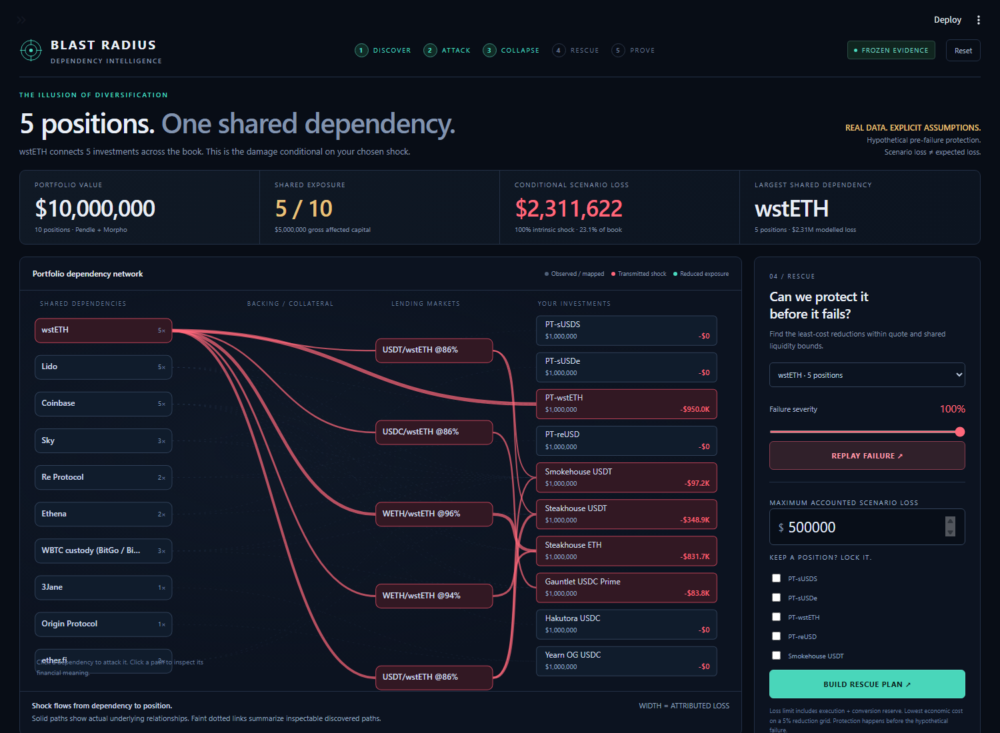
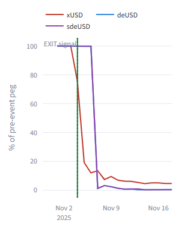
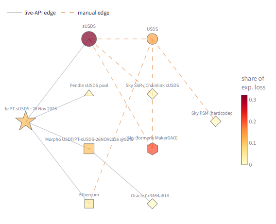
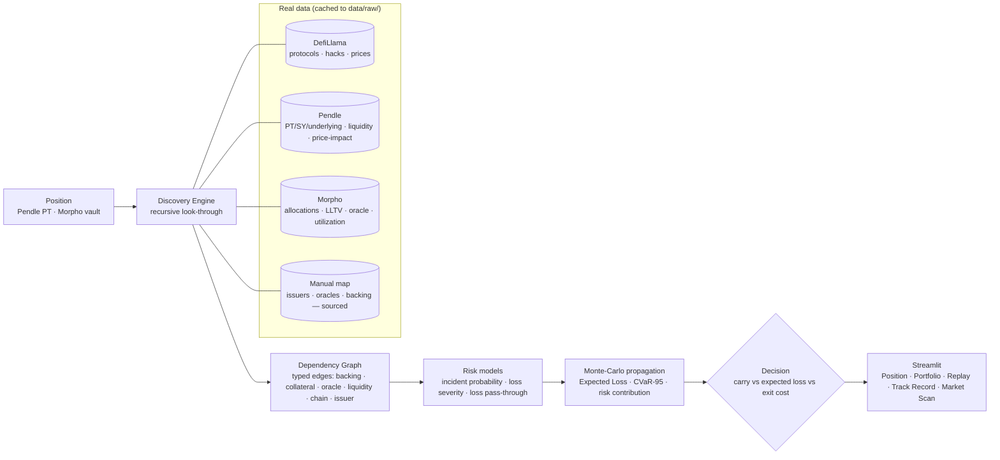

# Blast Radius — Ten Positions. One Hidden Bet.

**Discover → Attack → Collapse → Rescue → Prove.** An interactive portfolio fire drill for the Belem Capital DeFi Risk Dependency Challenge.

The new landing experience automatically ranks shared dependencies in a real cached $10M, ten-position book. Its computed weakest shared dependency is **wstETH across five positions**: a Pendle position and four Morpho vaults. Click any discovered dependency, change the shock severity, and inspect the actual paths that transmit the modelled loss. Then find the least-cost protection within captured quote and shared market-liquidity bounds.



The frozen wstETH scenario produces **$2,311,622 conditional loss**. With a **$500,000 accounted-loss limit**, the discrete optimizer finds **$498,866 accounted loss** at **$21,753 economic cost** (execution, conversion reserve and thirty-day foregone carry). These are hypothetical pre-failure calculations, not predictions or executed returns. The break-even probability of this exact scenario over thirty days is **1.19%**, not an empirically estimated probability. Generated figures and all actions: [`artifacts/fire_drill.json`](artifacts/fire_drill.json).

The new deterministic engine treats alternate paths through the same claim as overlapping, adds separate funded vault allocations, and estimates lending loss from incremental aggregate collateral shortfall. It does **not** reuse independent-event survival to compound one shared event. Recovery assumptions, coefficient assumptions, unknown collateral and omitted loan-asset issuer risk are exposed. The original Monte Carlo expected-loss research remains available in the sidebar and is a separate model.

**Execution evidence:** 80 captured Pendle candidate quotes, RPC-verified token decimals (PT-reUSD has **6**, not 18), and Morpho funded allocations with shared market capacities. No failed quote becomes an invented fill. Snapshot liquidity bounds do not certify withdrawal queues or future execution. Two-basis-point gas and ten-basis-point cash-conversion reserves are assumptions. Released capital is assumed transferred to external cash before failure.

```powershell
.venv/Scripts/python.exe -m streamlit run app/Home.py
# Native-control fallback: http://localhost:8501/?fallback=1
.venv/Scripts/python.exe -m unittest discover -s tests -v
.venv/Scripts/python.exe scripts/build_fire_drill_artifacts.py
.venv/Scripts/python.exe scripts/verify_receipt.py
.venv/Scripts/python.exe scripts/verify_fire_drill.py --record
```

The presentation forces offline operation. `scripts/capture_fire_drill.py` is the explicit, read-only network capture step; it never submits transactions. The evidence drawer exports a receipt containing source hashes, candidates, constraints, actions and independently recomputed totals. Verify any downloaded receipt with `scripts/verify_receipt.py <path>`.

See [`DEMO.md`](DEMO.md) for the two-minute story. No framework migration, new ML, wallet access or automatic trading is required.

---

## Preserved expected-loss research

**What is the blast radius of a DeFi position when one of its hidden dependencies fails — and is the expected loss from staying high enough to justify exiting despite slippage?**

Blast Radius is a Python engine + Streamlit dashboard for the BSA EPFL × **Belem Capital** *DeFi Risk Dependency Challenge*. It discovers dependencies, propagates failures with Monte-Carlo, and returns a **STAY / REDUCE / EXIT** call — illustrated by the **Stream Finance → Elixir deUSD** collapse and evaluated retrospectively on selected historical pairs, including misses and false alarms.

> *Belem's brief:* "Build a working risk system that, for an on-chain position, automatically discovers its hidden dependencies … estimates the economic impact if a dependency fails and shows how the incident propagates … and answers the portfolio manager's real question: is the expected loss from staying high enough to justify exiting despite slippage and execution costs?"

Market inputs are **real cached data** (DefiLlama, Pendle, Morpho), so the demo is **offline and reproducible**. Exposure estimates, risk priors, execution assumptions and manual/reconstructed links are modelling inputs, labelled with sources and limitations.

---

## The hero result (Replay tab) — real Nov-2025 prices

You hold **$1,000,000 of Elixir sdeUSD**, a yield-bearing dollar trading at peg. Underneath, **~65% of deUSD's backing was a loan to Stream Finance**, collateralised by Stream's xUSD. Blast Radius discovers that hidden chain and watches the **upstream** asset:

- **Nov 1–3:** xUSD at peg → **REDUCE** because **APY=0**: any positive EL makes `net_stay = -EL < 0`, so STAY is unavailable; EXIT requires EL to clear the assumed 1% unwind cost. This is not evidence of a pre-break prediction.
- **Nov 4:** Stream discloses a ~$93M loss and freezes xUSD; **xUSD breaks to $0.95** — but deUSD/sdeUSD are *still at peg ($1.07)*. Blast Radius flips to **EXIT**.
- **Nov 7:** deUSD and sdeUSD collapse to **~$0.01**.

The replay's **99.7% avoided-price-loss figure** compares the Nov-4 sdeUSD price with the last daily price, **before execution costs**. It is not an executed return. The daily replay labels a three-day lead. **Stream is the development case**, built knowing its outcome; Track Record uses a common 4h series and a simpler two-node graph, so its timings and cost-adjusted scores differ.



---

## What it does (Home + five pages)

| Tab | What you see |
|---|---|
| **Position** | Input a live position → interactive **dependency graph** (live-API vs manual edges) coloured by risk → per-node risk table → loss histogram → **STAY/REDUCE/EXIT** verdict with a plain-English reason → **what-if** panel that forces any dependency to fail and re-propagates. |
| **Portfolio** | A book of up to 10 positions → **shared-dependency detection** ("5 of 10 depend on Lido") → position×dependency **exposure heatmap** → ranked actions by carry-minus-loss. |
| **Replay: Stream Finance** | Day-by-day replay on real prices: timeline slider, per-day verdict + narrative, %-of-peg chart with the EXIT-signal marker, and the daily dependency-graph state. |
| **Track Record** | Every selected pair, including misses, same-bar signals, control-window false alarms, and the separate Stream development case. |
| **Market Scan** | Qualifying Ethereum vaults/markets; issuer/token/oracle exposures, EL-minus-carry ranking, opaque positions and coverage boundaries. |

Live look-through of a Pendle PT-sUSDS position — the 5 layers (settlement chain, Pendle AMM, underlying→issuer, oracle, lending market) fall out of generic recursion; node colour = share of expected loss, dashed edges = sourced manual facts:



---

## Architecture



---

## Methodology

### 1. Recursive look-through discovery (`blast_radius/discovery/`)
A position is the graph root. Per-kind resolvers expand it into typed dependency edges, then the engine recurses over token nodes until it reaches base assets or the settlement chain. **The 5-layer Pendle example falls out of generic recursion — it is not hard-coded.**
- **Pendle PT** → settlement chain, the Pendle **AMM** (exit venue), the **underlying** (SY→asset), and the **lending markets that hold the PT as collateral** (contagion channel) with their **oracles** and **LLTV**.
- **Morpho vault** → each allocated **market** (with LLTV, utilization, oracle address) → **collateral token** → which recurses (a PT collateral unwraps into *its* underlying and AMM; a wrapper into its backing → issuer).
- Each edge carries a **dependency type**, an **exposure %** (allocation share / backing share), and its **data source**. Facts the APIs don't expose (some oracles, off-chain issuers, backing) come from a small **manual map** with a source URL per entry and render as **dashed "manual" edges**.

### 2. Risk models (`blast_radius/models/`)
- **Incident probability** — base-rate hazard per DefiLlama **category** and per hack **classification** from the real `/hacks` dataset joined to `/protocols`; stablecoin-like classes blend a documented **depeg prior** (because depegs aren't "hacks"). A gradient-boosting panel model is trained and evaluated honestly (below).
- **Loss severity** — Beta per risk category; the means are informed by the **empirical loss/TVL distribution per classification** computed from `/hacks`.
- **Loss pass-through** — a **flat coefficient per dependency type**, multiplied by exposure share. Oracle edges use **0.70**, liquidity edges **0.35**. **LLTV is shown in labels only**; `liquidation_loss()` exists but is never called by propagation. Wiring LLTV into the edge factor remains future work. Coefficients are assumptions informed by a small set of incidents.

### 3. Monte-Carlo propagation (`blast_radius/risk/propagate.py`)
Each Monte-Carlo path samples one shock per canonical node and propagates it **up** the graph with a *multiplicative survival* rule bounded in [0,1]. A shared dependency can still affect multiple downstream branches; this is not a joint reserve or liquidation simulator. Outputs: **loss distribution, Expected Loss, CVaR-95**, and per-node contributions. Scan exposure uses the **maximum transmission over paths** once per dependency per position.

### 4. Exit cost & decision (`blast_radius/risk/`)
- **Exit cost** is real: Pendle PT uses the **SDK swap price-impact** at the position size (with a size→impact curve); a Morpho vault uses **withdrawable liquidity** (and an illiquidity penalty beyond it).
- **Decision:** compare the expected net P&L of holding (`carry − expected loss`) against the cost of exiting; **EXIT** when expected loss beats carry by more than the exit cost, **STAY** when carry covers the loss and the tail is tolerable, **REDUCE** otherwise (including a fat **CVaR-95** tail). The reason names the dominant risk path.

---

## Model evaluation (reported honestly)

Incident model: a gradient-boosting classifier on a **15,350-row protocol×year panel** (2021–2025), time-split (train ≤ 2023, test 2024–25), isotonic-calibrated. Test prevalence **0.95%** (96 positive protocol-years) — severe class imbalance, as expected.

| Model | ROC-AUC | PR-AUC | Brier |
|---|---|---|---|
| Gradient-boosting panel | 0.6654 | 0.0176 | 0.009435 |
| **Category base-rate (baseline)** | 0.6274 | **0.0182** | 0.009816 |

The model **edges out the base rate on ROC-AUC and Brier, not PR-AUC; base-rate priors remain the production backbone**. Values come from `artifacts/metrics.json`. Current TVL, audits, chain counts and protocol metadata introduce look-ahead/survivorship limitations; this is not a fully point-in-time panel. Regenerate with `python scripts/train_incident_model.py`, then `python scripts/update_reports.py`.

**Pass-through calibration (real Nov-2025 incidents, small sample stated openly):** on Nov 7, Stream xUSD had lost ~87% and deUSD ~99%; with ~65% Stream-backed, the "fundamental" deUSD loss ≈ 0.65 × 0.87 ≈ 57% but the market overshot to ~99% — an overshoot factor of **≈1.7×** in a confidence-run. Our `backing` pass-through (0.95) is deliberately conservative against that panic overshoot.

---

<!-- BEGIN COMPUTED REPORTS -->
## Track record

Excluding Stream: **2/6 advance catches**, **4 misses**
(including 3 same-bar signals), **6h median lead** among catches,
and **$94,535 saved versus a naive 5% price-watcher** on $1M per pair.
Savings include every pair, including late exits. If no EXIT fires, the held position is valued
at its observed worst-14d mark, an unrealized valuation. Both exit strategies assume 1% cost on sale proceeds.

Including the Stream development pairs: **4/8 catches**,
**36h median lead**, **$1,878,696 saved vs naive**.
Controls exclude Stream (no comparable 2024 data): **2.285 false alarms per pair-year**,
from **4 alarms over 1.750 observed pair-years**.
The descriptive stablecoin/CRV breakdown was added after observing controls:
0.000 vs
33.953 alarms per pair-year.
Missing intervals and incomplete 7-day-reference/14-day-follow-up windows are excluded, not treated as calm.

**Limits:** six non-development pairs share **2 distinct crises**;
selection was retrospective for data availability and visible breaks, not prospective holdout validation.
All exposure shares are estimated; CRV is a volatile stress proxy, not the exploited pool itself.
Prices use **4h buckets**, as-of alignment and bounded forward-fill; lead times and assumed exit
prices are uncertain within that sampling interval. The model's risk priors are current, not
historical point-in-time estimates. **Stream is the development case**; no ML early-warning
benchmark is claimed (`rule_vs_ml: null`). Parameters, every pair and sources:
[`artifacts/backtest_results.json`](artifacts/backtest_results.json).

## Market scan

**$435,998,291 gross TVL + AMM liquidity** across **37 positions**:
12 listed Ethereum Morpho V1 vaults ≥ $10M and
25 active Pendle markets ≥ $1M liquidity. Cached universe:
45 listed vaults and 47 active markets;
all qualifying positions analysed, 0 failures.

Largest shared issuer dependency: **Lido — $51,532,121 transmission-weighted
notional across 8 positions**. Top-three issuer concentration index:
**29.1%**, using a capped sum of dominant-path transmissions
per position. Whole-position mapping coverage is **52.5%** to declared
issuer/base-asset depth; **47.5% opaque** (21/37
positions have no unmapped discovered token).

**Limits:** Ethereum only, listed V1 vaults/active markets only, thresholded cached snapshots.
Gross TVL plus pool liquidity can count the same economic capital twice. Transmission-weighted
notionals are model exposures, not unique dollars at risk; dependency columns are not additive.
Manual mappings do not establish complete reserves, validator operators, off-chain counterparties
or tranche waterfalls. Morpho discovery follows funded collateral, excluding loan-asset issuer
risk and idle/dust allocations. Scan ranking is EL minus carry; Pendle scan exit costs are assumed,
not executable quotes for entire pools. Source-cache dates, coverage and full results:
[`artifacts/market_scan.json`](artifacts/market_scan.json).

<!-- END COMPUTED REPORTS -->

## Data sources (all free, no API key)
- **DefiLlama** — `/protocols` (catalog, category, chains, TVL, audits, listedAt), `/protocol/{slug}` (TVL history), `/hacks` (1,299 incidents), `coins.llama.fi` current/historical/`chart` prices.
- **Pendle** `api-v2.pendle.finance` — `/v1/{chain}/markets/active`, `/v2/.../data`, `/v2/sdk/.../swap` (real price-impact), `/v1/.../assets/prices`.
- **Morpho** `blue-api.morpho.org/graphql` — vault allocations, markets, collateral, LLTV, oracle address, utilization (current + historical).
- **Manual map** (`data/manual/dependencies.yaml`) — issuers / oracles / backing the APIs don't expose; **one source URL per entry**, labelled "manual" in the UI.
- **Replay** (`data/replay/stream_snapshot.yaml`) — the contagion *structure* is reconstructed from sourced post-mortems (The Block, Pharos, BlockEden, CoinDesk) and labelled "reconstructed"; the *price series* are real DefiLlama data.

Every response is cached to `data/raw/` (committed) so the demo runs offline. `python refresh_cache.py` rebuilds the cache.

---

## Assumptions & limitations (openly)
- **Incident base rates** use documented depeg priors for stablecoin-like classes that `/hacks` under-counts; flagged as priors in the UI.
- **Severity loss/TVL** uses *current* protocol TVL as a denominator (post-incident) — a rough approximation, stated.
- **Pass-through** is calibrated on a **small sample** (n≈3 real 2025 events); we expose sensitivity rather than claim precision, and linear multiplicative transmission understates panic overshoot.
- **Incident ML model** improves ROC-AUC and Brier, not PR-AUC, under 0.95% prevalence — base-rate priors remain the backbone.
- Manual mappings reach declared issuer/base-asset depth; a known issuer does not establish complete reserves. Unmapped tokens remain opaque. Morpho loan-asset issuer risk is outside the collateral graph.
- Research tooling for a hackathon — **not financial advice**.

---

## How to run

```bash
python -m venv .venv
.venv/Scripts/pip install -e .          # macOS/Linux: .venv/bin/pip
python refresh_cache.py                 # one network run to build data/raw/ (optional; cache is committed)
./run.ps1                               # Windows   (macOS/Linux: ./run.sh)
```
`run.ps1` launches the dashboard from cached data. For a strict offline demo: `set BLAST_RADIUS_OFFLINE=1` (PowerShell: `$env:BLAST_RADIUS_OFFLINE=1`) before launching.

**Demo positions** (cached API snapshot): a Pendle **PT-sUSDS** PT and the **Morpho Smokehouse USDT** vault (**12 funded markets rendered**, from 22 raw allocations after idle/dust filtering). A 10-position sample book is in `data/book/sample_book.json`.

Recompute from the committed cache:

```powershell
$env:BLAST_RADIUS_OFFLINE = "1"
.venv/Scripts/python.exe scripts/run_backtest.py
.venv/Scripts/python.exe scripts/run_market_scan.py --restart
.venv/Scripts/python.exe scripts/update_reports.py
.venv/Scripts/python.exe -m unittest discover -s tests -v
```

`--restart` recomputes analyses using the cached snapshot; it does not refresh market data. Checkpoints resume only when the universe, configuration, mapping and analysis-code fingerprints match.

Offline Chromium verification covers all six pages, the Position shock toggle and vault selector,
Replay dates, and sidebar navigation. Results and source hashes are in
[`artifacts/verification.json`](artifacts/verification.json), with screenshots in
[`artifacts/screenshots/`](artifacts/screenshots/). To repeat with the offline app running,
install the optional development tools, then run:

```powershell
.venv/Scripts/python.exe -m pip install playwright
$env:PLAYWRIGHT_BROWSERS_PATH = "$PWD/.playwright-mcp/browsers"
.venv/Scripts/python.exe -m playwright install chromium
.venv/Scripts/python.exe scripts/verify_app.py
```

---

## Repo structure
```
blast_radius/
  sources/     defillama · pendle · morpho (cache-through clients)
  discovery/   graph · resolvers · engine (recursive look-through)
  models/      incidents · severity · passthrough
  risk/        propagate (Monte-Carlo) · exit_cost · decision
  portfolio/   book (shared deps + ranking)
  replay/      stream (Nov-2025 replay)
  backtest/    frozen rule, historical pairs, prices, controls, scoring
  scan/        universe, resumable analysis, dollar exposures
app/           Home + Position · Portfolio · Replay · Track Record · Market Scan
scripts/       probe_data.py · run_backtest.py · run_market_scan.py · update_reports.py
data/          raw/ (cache) · manual/ · replay/ · book/ · backtest/
```

MIT licensed. Built with Claude Code.
